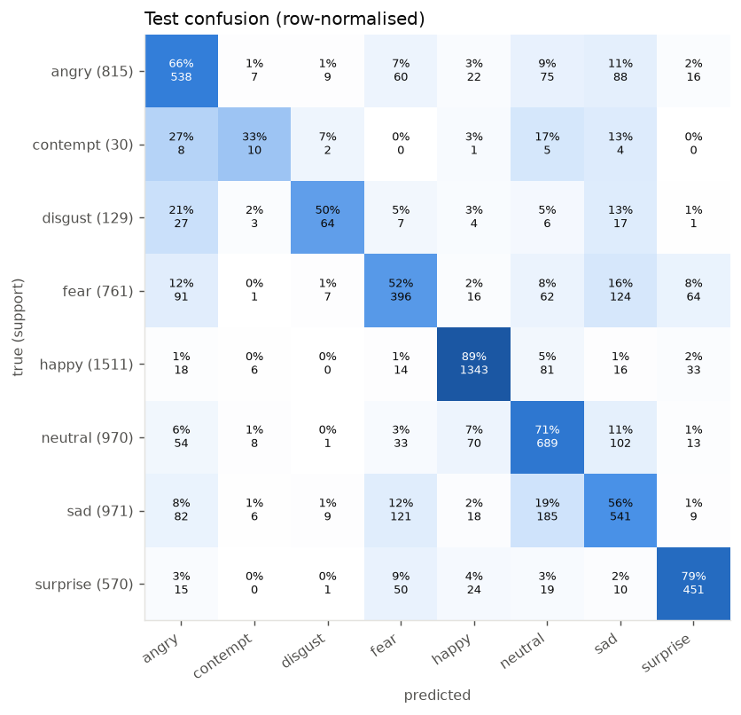
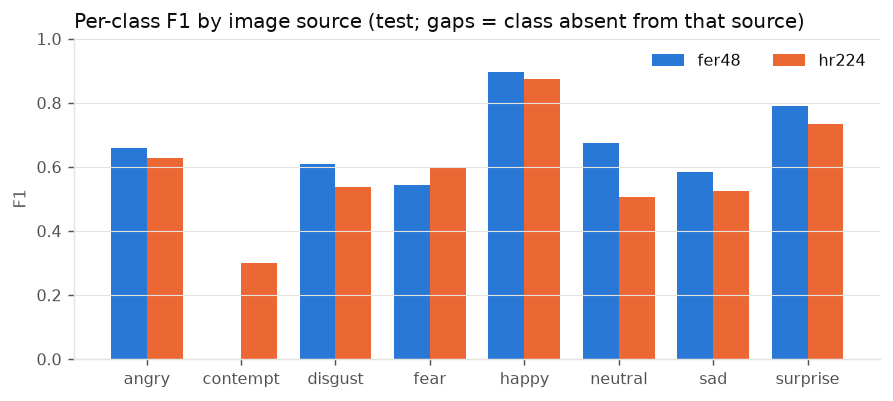
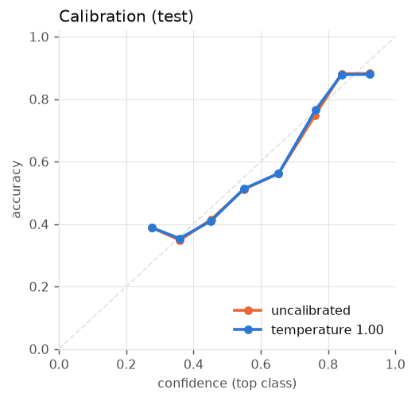
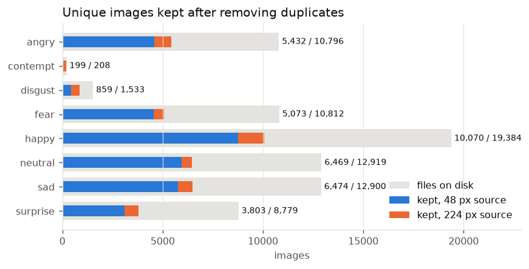
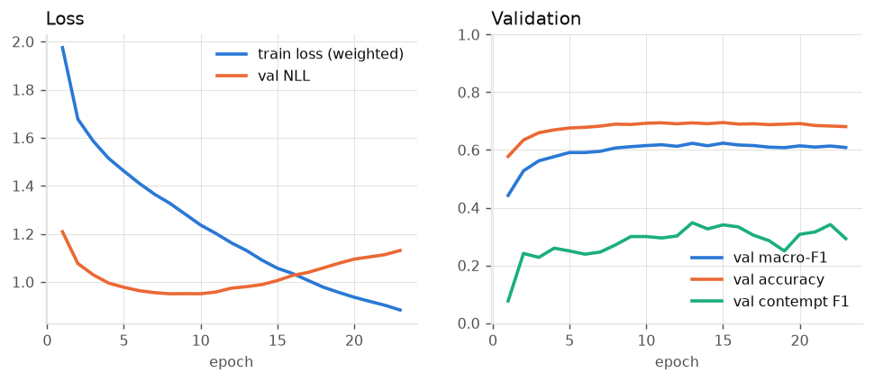

# MoodTune: facial-emotion music recommender 

MoodTune reads your facial expression from the browser camera (or an uploaded photo),
classifies it into one of eight emotions, and suggests music as YouTube search links. You
choose whether the music should **match** your mood or **lift** it.

Quick links: [Repository](https://github.com/ManuSasikanthOruvilakode1/MoodTune-Facial-Emotion-Music-Recommender) | [License (MIT)](LICENSE)

Every number below comes from a held-out test set of faces that, along with any copies of
them, never appeared in training. `scripts/reproduce.sh` regenerates all of them from the raw
image folders.

## Results

Test set: 5,757 unique faces (15% of the de-duplicated data, stratified by emotion and source).
Brackets show 95% bootstrap intervals.

| Model | Init | Accuracy | Macro-F1 | Macro-F1 w/o contempt | ECE |
|---|---|---|---|---|---|
| **ConvNeXt-nano, 160 px** (deployed) | ImageNet-12k | **0.700** [0.689, 0.712] | **0.621** [0.598, 0.642] | 0.670 | 0.045 |
| ConvNeXt-nano, 160 px | random | 0.651 [0.639, 0.664] | 0.577 [0.553, 0.600] | 0.620 | 0.049 |
| Original Keras CNN, ported to PyTorch, 48 px | random | 0.635 [0.623, 0.647] | 0.520 [0.496, 0.544] | 0.570 | 0.017 |

The baseline is the original project's network, trained on the same de-duplicated split.
That makes it a fair comparison of models; the original project itself has no trustworthy
number to compare against (see [What was wrong](#what-was-wrong-with-the-original)).
Pretraining is worth about 5 points of accuracy over the same network trained from random
init (which was still creeping up at its 80-epoch cap; best epoch 73), and the modern
network trained from scratch beats the original one by about 2 points of accuracy and 6 of
macro-F1. Top-2 accuracy of the deployed model is 0.839.

**Per class** (deployed model):

| Emotion | Precision | Recall | F1 | F1 95% CI | Test images |
|---|---|---|---|---|---|
| happy | 0.897 | 0.889 | 0.893 | 0.88–0.90 | 1,511 |
| surprise | 0.768 | 0.791 | 0.780 | 0.75–0.81 | 570 |
| neutral | 0.614 | 0.710 | 0.659 | 0.63–0.68 | 970 |
| angry | 0.646 | 0.660 | 0.653 | 0.62–0.68 | 815 |
| sad | 0.600 | 0.557 | 0.578 | 0.55–0.60 | 971 |
| disgust | 0.688 | 0.496 | 0.577 | 0.50–0.65 | 129 |
| fear | 0.581 | 0.520 | 0.549 | 0.52–0.58 | 761 |
| contempt | 0.244 | 0.333 | 0.282 | 0.14–0.42 | 30 |



The usual FER confusions dominate: sad ↔ neutral, fear → sad, and disgust → angry.

**By image source.** The data mixes two collections (see [Data](#data)), so results are
reported for each one:

| Source | Test images | Accuracy | Macro-F1 |
|---|---|---|---|
| 48 px FER-style | 4,976 | 0.708 | 0.679 (7 classes) |
| 224 px in-the-wild | 781 | 0.653 | 0.588 (8 classes) |



**Calibration.** Temperature scaling was fitted on the validation split and came out at
T = 1.00: the model was already calibrated (test ECE 0.045, NLL 0.98). The app relies on this
when it says "not sure" below 40% confidence.



**Grad-CAM** (`runs/pretrained/report/gradcam.png`, kept out of the repo because it shows
dataset faces). Attention falls on the mouth, eyes and brows for nearly every class.

**Deployed path.** The live pipeline, not just the test crops, was checked end to end. 400
held-out 224 px test faces were pasted into 640×480 frames and run through YuNet detection,
eye alignment, re-cropping and ONNX inference. Accuracy on the detected faces was 0.632, against
0.635 when the model sees the dataset crops directly, so the pipeline loses nothing measurable.
The ONNX export matches PyTorch to 2e-5 in the logits, with 100% top-1 agreement.

**Latency** (laptop CPU, ONNX Runtime): face detection takes 7.7 ms on a 640×480 frame and
the emotion model 10.3 ms per face (p50), so a webcam stream at 6 fps uses about 11% of one core.

### The contempt caveat

All 208 contempt images come from the 224 px collection, so the model can only learn
contempt from one source. The data shows it did:

- On the 4,976 48 px test faces, the model predicted contempt **4 times**. On the 781 224 px
  test faces, it predicted contempt **37 times**.
- A linear probe on the model's embeddings recovers the image source with 0.89 balanced
  accuracy, even though every image is reduced to the same 48 px grayscale format and JPEG
  re-compression is applied in training.
- In one Grad-CAM example, a contempt prediction looks at an image corner where the stock
  photo watermarks sit.

The contempt score (F1 0.28, CI 0.14–0.42) is therefore both unreliable and partly a shortcut.
The class is kept as decided, and the app labels it experimental. The cleaner options are
more contempt images from the 48 px source, or dropping the class:
`macro-F1 w/o contempt` above shows what the other seven classes achieve.

## Data

`data/<emotion>/` holds 77,331 grayscale images in 8 classes from two collections:

- **fer48**: 48×48 JPEGs in the style of FER-2013 (92% of files)
- **hr224**: 224×224 PNGs of in-the-wild web photos, some with stock watermarks (8%); the
  only source of `contempt`

`moodtune prepare` decodes every file once and builds the training set in four steps:

1. Reduce each image to a canonical 48×48 grayscale face. Every source, and later every
   webcam crop, goes through the same `preprocess.canonical`, so size and format cannot
   identify the source.
2. Drop **exact duplicates**, meaning identical decoded pixels. Half the files are copies:
   most 48 px images are stored twice under different numbers, e.g.
   `img-anger (1).jpg` and `img-anger (5961).jpg`.
3. Drop **near duplicates**: pixel correlation ≥ 0.95 with another image or its mirror image,
   checked exhaustively over all pairs. These are re-encoded, mirrored or lightly edited copies.
4. Drop **label conflicts** (the same image filed under two emotions, 984 files) and
   **blank** images (26).

| | Files | Unique, kept | Train | Val | Test |
|---|---|---|---|---|---|
| angry | 10,796 | 5,432 | 4,074 | 543 | 815 |
| contempt | 208 | 199 | 149 | 20 | 30 |
| disgust | 1,533 | 859 | 644 | 86 | 129 |
| fear | 10,812 | 5,073 | 3,805 | 507 | 761 |
| happy | 19,384 | 10,070 | 7,552 | 1,007 | 1,511 |
| neutral | 12,919 | 6,469 | 4,852 | 647 | 970 |
| sad | 12,900 | 6,474 | 4,856 | 647 | 971 |
| surprise | 8,779 | 3,803 | 2,852 | 381 | 570 |
| **total** | **77,331** | **38,379** | 28,784 | 3,838 | 5,757 |



**Why the dedup matters.** With a plain random 80/20 split of the files, which is what the
old notebook's `validation_split` did, **75% of test images have an exact copy in the
training set**. With this pipeline the share is 0.0%, and 0.0% of test images have a near-twin
(correlation ≥ 0.95, mirrors included) in training (`artifacts/split_report.json`).

The split is stratified by (emotion, source) and is deterministic (seed 42). It is written
to `artifacts/manifest.csv` along with each file's status (`kept`, `duplicate`,
`near_duplicate`, `label_conflict`, `blank`) and which image it duplicates.

## Training

- **Backbone**: `convnext_nano.in12k_ft_in1k` (timm, 15 M parameters), fine-tuned end to end
  with a 10× lower learning rate on the backbone. The 48 px face is upsampled to 160 px and
  replicated to 3 channels.
- **Imbalance** (happy outnumbers contempt 50:1 after dedup): class-weighted cross-entropy
  with inverse-sqrt weights (contempt 5.3×, disgust 2.6×, happy 0.75×) plus label smoothing
  0.1. The model is selected by validation **macro-F1**, not accuracy.
- **Augmentation**: random resized crop, flip, small affine, brightness and contrast, random
  JPEG re-compression (applied to both sources), blur and random erasing.
- AdamW with warmup and cosine decay, bf16 mixed precision, EMA weights (0.999), early
  stopping (patience 8), then temperature scaling on validation.



The best epoch was 15. Validation NLL starts rising after epoch 10 while macro-F1 levels off,
and early stopping ends the run at epoch 23.

## The app

```
browser camera ──JPEG frames over WebSocket──▶ FastAPI ──▶ YuNet face detector
      ▲                                                   │  largest face, eyes levelled,
      │                                                   ▼  square crop + 10% margin
      └──── emotion, smoothed probabilities, ◀── ONNX Runtime emotion model (calibrated)
            YouTube links (JSON reply)                    │
                                                          ▼
                                     per-connection smoother  ──▶  music recommender
```

- **The camera runs in the browser.** The old app opened the webcam of the machine running the
  server. Frames are JPEG-encoded at 480 px wide. The client sends the next frame only after
  the previous one is answered (6 fps at most), so the server never builds a queue.
- **Photo upload** (`POST /api/analyze`) works without a camera.
- **Nothing is written to disk.** Frames are decoded, analysed and discarded in memory; there
  is no `static/face.jpg`. The API test runs in an empty working directory and asserts that it
  is still empty afterwards.
- **Temporal smoothing** (per WebSocket connection): an EMA of the probability vector, a
  challenger emotion must lead by 0.10 for 1 s before it replaces the current one, and the
  state resets after 2 s with no face.
- **Face detection**: OpenCV's YuNet (2023, shipped in `models/`, 230 KB). It provides eye
  landmarks for alignment. The Haar cascade is only a fallback on OpenCV 4.x, because
  OpenCV 5 moved it out of the main package.
- **Music**: each emotion has `match` and `lift` query lists in `configs/default.yaml`
  (`music.queries`). Edit them freely; the first query is the main pick and the rest are
  shown as alternatives. `lift` falls back to `match` for emotions with nothing to lift
  (happy, neutral, surprise). Below 40% confidence the app says it is unsure and suggests
  neutral music. Links open in your browser; nothing is opened on the server.

API: `GET /api/health`, `GET /api/meta`, `POST /api/analyze?strategy=`,
`GET /api/recommend?emotion=&confidence=&strategy=`, `WS /api/stream`.

## Quick start

Requires [uv](https://docs.astral.sh/uv/) and Python 3.12. CUDA is used for training if
available.

```bash
uv sync
uv run moodtune prepare                 # dedup + split + cache            (~2 min)
uv run moodtune train --name pretrained # fine-tune                        (~15 min, RTX 4060)
uv run moodtune evaluate runs/pretrained
uv run moodtune export runs/pretrained  # -> models/moodtune.onnx, with parity check
uv run moodtune serve                   # http://127.0.0.1:8000
```

Other commands: `moodtune predict photo.jpg` (or `--no-detect` for already-cropped faces)
and `moodtune bench`. Any config value can be overridden with `-s section.key=value`.

Browsers allow camera access only on `localhost` or over HTTPS. To use the app from another
device, put it behind a TLS proxy. Photo upload works either way.

**Docker** (inference only: ONNX Runtime + OpenCV, no PyTorch, no data):

```bash
docker build -t moodtune . && docker run -p 8000:8000 moodtune
```

## Engineering

- `uv run pytest`: 28 tests on synthetic images, covering planted exact, mirrored and
  re-encoded duplicates, label conflicts, split determinism and leakage, class weights, model
  forward passes and Grad-CAM hooks, a one-epoch training run, ONNX export parity, eye
  alignment, smoothing, the recommender, and every HTTP and WebSocket endpoint.
- `uv run ruff check src tests` and `ruff format`.
- GitHub Actions CI (`.github/workflows/ci.yml`) runs lint and tests with CPU-only torch.
  It never touches the face dataset.

## What was wrong with the original

The original code is kept in `legacy/` for reference (without the unloadable `model.h5` and the Haar XML, which were removed).

- `train-test.ipynb` was pointed at the gym-equipment dataset ("Found 852 images belonging
  to 4 classes"), so the emotion model had no training record.
- `train_test.py` saved weights only (`save_weights`), but `rec.py` called `load_model`, so
  `model.h5` could not be loaded. The script also expected `data/train` and `data/test`
  folders that did not exist.
- `rec.py` knew 7 classes and spelled one "suprise", while the data has 8, so every label
  after `angry` would have been shifted.
- There was no test set, and a random split would have leaked 75% of test images through
  duplicates.
- The app opened the server's webcam, looped forever when no face was visible, wrote every
  face to `static/face.jpg` (a privacy problem and a race between users), and called
  `webbrowser.open()` on the server.

## Limitations

- A facial expression is not the same as a felt emotion, and posed or in-the-wild web photos
  differ from a webcam at a desk. Treat the output as a playful guess, not a measurement.
- Accuracy across age, gender and skin tone was not measured: the dataset has no such labels.
  FER-style datasets are known to be skewed.
- The images are third-party datasets of real people's faces. They are not redistributed
  here (`data/` is git-ignored); check their licences before any use beyond research.
- Contempt: see [the caveat above](#the-contempt-caveat).

## Project structure

```
MoodTune-Facial-Emotion-Music-Recommender/
├── .github/
│   └── workflows/
│       └── ci.yml                  # lint + tests on every push (CPU-only torch)
├── configs/
│   └── default.yaml                # every setting, including the music queries
├── docs/
│   └── figures/                    # figures used in this README
│       ├── calibration.png
│       ├── confusion.png
│       ├── dataset.png
│       ├── f1_by_source.png
│       └── history.png
├── legacy/                         # the original project, kept for reference
│   ├── rec.py                      # old Flask app
│   ├── train_test.py               # old Keras training script
│   ├── train-test.ipynb            # old notebook
│   ├── static/style.css
│   └── templates/
│       ├── emotion_detect.html
│       └── index.html
├── models/
│   └── face_detection_yunet_2023mar.onnx   # YuNet face detector (OpenCV model zoo)
├── scripts/
│   ├── reproduce.sh                # regenerates every number in this README
│   └── serve.py                    # minimal server entry point (Docker)
├── src/
│   └── moodtune/
│       ├── __init__.py
│       ├── cli.py                  # `moodtune` command: prepare, train, evaluate, export, ...
│       ├── config.py               # typed YAML config
│       ├── labels.py               # the 8 emotions and the 2 image sources
│       ├── preprocess.py           # canonical face + network input (NumPy/OpenCV only)
│       ├── data/
│       │   ├── __init__.py
│       │   ├── manifest.py         # scan, canonicalise, exact + near-duplicate removal
│       │   ├── split.py            # stratified split + leakage report
│       │   └── dataset.py          # PyTorch dataset, augmentation, class weights
│       ├── model.py                # ConvNeXt (timm) or ported legacy CNN
│       ├── train.py                # training loop: AMP, EMA, early stopping, calibration
│       ├── metrics.py              # macro-F1, per class/source, ECE, bootstrap CIs
│       ├── report.py               # figures, Grad-CAM
│       ├── export.py               # ONNX export + parity check
│       ├── predictor.py            # ONNX Runtime inference
│       ├── face.py                 # YuNet / Haar detection, aligned cropping
│       ├── analyzer.py             # frame -> faces -> emotions (in memory)
│       ├── smoothing.py            # temporal smoothing for the webcam stream
│       ├── music.py                # emotion -> YouTube search links
│       └── api/
│           ├── __init__.py         # FastAPI app: HTTP + WebSocket
│           └── static/             # browser UI (no CDN)
│               ├── index.html
│               ├── app.js
│               └── style.css
├── tests/
│   ├── conftest.py                 # synthetic dataset with planted duplicates
│   ├── test_data.py
│   ├── test_model.py
│   └── test_app.py
├── .gitignore
├── .python-version
├── Dockerfile                      # inference-only image
├── pyproject.toml
├── uv.lock
├── LICENSE                         # MIT
└── README.md
```

Generated locally and not committed (see `.gitignore`):

```
data/            # the face images, one folder per emotion (not redistributed)
.cache/faces/    # canonical 48 px faces written by `moodtune prepare`
artifacts/       # manifest.csv, split_report.json, logs
runs/            # checkpoints, metrics and report figures per training run
models/moodtune.onnx   # the exported emotion model (`moodtune export`)
```

## License

The code is released under the [MIT License](LICENSE). The MIT license covers this
repository's code only: the face images used for training are third-party data and are not
included, and the YuNet model in `models/` is distributed by OpenCV under its own license.
